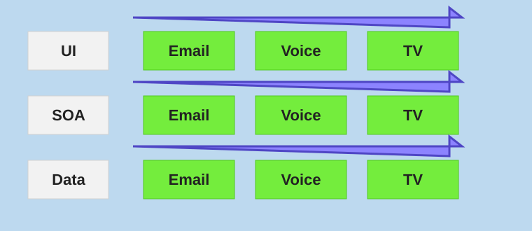

# Introduction to DevOps

> "DevOps is the union of people, process, and products to enable continuous delivery of value to our end users." - Donovan Brown in *What is DevOps?*

## DevOps focus areas

- **Strategic Planning:** How to plan for DevOps transformation and avoid common pitfalls.
- **Source Control:** Use and scale Git for enterprise environments.
- **Team Collaboration:** Combine artifacts and design effective dependency management strategies.
- **Security Integration:** Manage secrets and implement security throughout the pipeline.
- **Automation Excellence:** Implement continuous integration and container-build strategies.
- **Delivery Optimization:** Design release strategies and deployment patterns.
- **Feedback Loops:** Set up monitoring and optimize feedback mechanisms.
- **Cultural Transformation:** Build cross-functional teams and establish shared goals.

## Business Value of DevOps

- **Deployment frequency:** Increased from infrequent releases to regular, predictable deployments.
- **Lead time:** Reduced from extended development cycles to shorter delivery timeframes.
- **Mean time to recovery (MTTR):** Faster incident resolution and system restoration.
- **Change failure rate:** Fewer production issues due to improved testing and automation.

## Cycle Time Calculation Exercise

Think about your current development process. How long does it take to go from:

- Code commit -> Production deployment?
- Feature request -> Customer feedback?
- Bug report -> Fix in production?

## Continuous Delivery

Continuous delivery enables rapid deployment of software solutions to production and testing environments, helping organizations quickly fix bugs and respond to ever-changing business requirements.

### Key benefits

- **Reduced deployment risk:** Smaller, frequent releases are easier to troubleshoot and roll back.
- **Faster time-to-market:** Features reach customers weeks or months sooner.
- **Improved reliability:** Automated deployments eliminate human error.
- **Better customer responsiveness:** Rapid response to feedback and market changes.

### Deployment strategies to consider

- **Blue-Green:** Zero-downtime deployments with instant rollback capability.
- **Canary:** Gradual rollout to a subset of users to minimize risk.
- **Feature Flags:** Deploy code without exposing features, enabling safer releases.

## Comprehensive Monitoring and Logging

Monitor running applications, including production environments, for application health and customer usage. This helps organizations create hypotheses and quickly validate or disprove strategies. Rich data is captured and stored in various logging formats.

### Monitoring stack components

- **Application Performance Monitoring (APM):** Track response times, errors, and throughput.
- **Infrastructure Monitoring:** CPU, memory, disk, and network metrics.
- **Business Metrics:** User engagement, conversion rates, and feature usage.
- **Security Monitoring:** Threat detection and compliance tracking.

### Observability best practices

- Implement distributed tracing for microservices.
- Use structured logging with correlation IDs.
- Set up proactive alerting with minimal false positives.
- Create dashboards for different audiences: operations, development, and business.

### Log management strategy

- Centralized logging with search capabilities.
- Retention policies based on compliance requirements.
- Cost optimization through log-level management.
- Real-time analysis for critical issues.

## Common DevOps anti-patterns to avoid

- **Tool-first approach:** Do not start by buying tools. Start with understanding your current state and desired outcomes.
- **Big bang transformation:** Avoid trying to change everything at once. Start small and expand gradually.
- **DevOps team silo:** Do not create a separate "DevOps team." DevOps is a practice, not a role.
- **Ignoring culture:** Technical changes without cultural change will fail. Invest in people and processes.
- **Skipping security:** Do not bolt on security at the end. Integrate security throughout (DevSecOps).
- **Over-engineering:** Start simple and add complexity only when needed. Avoid premature optimization.
- **Ignoring legacy:** Do not abandon existing systems. Plan gradual modernization strategies.

## Success patterns to embrace

- Start with high-impact, low-risk changes: automate builds before deployments.
- Measure everything: establish baselines before making changes.
- Fail fast and learn: embrace experimentation with proper safeguards.
- Invest in automation: automate repetitive, error-prone tasks first.
- Build feedback loops: create mechanisms to learn from both successes and failures.

## Building your DevOps transformation team

Research by Dr. Vijay Govindarajan and Dr. Chris Trimble in *Beyond the Idea: How to Execute Innovation* shows that successful innovation often occurs despite existing organizational processes. They concluded that it only works by creating a separate team to pursue the transformation.

### Core team composition: 3-7 people

#### DevOps Engineer/Lead

- **Primary responsibility:** Technical architecture and toolchain implementation.
- **Time commitment:** 100% dedicated to transformation.
- **Skills:** CI/CD, cloud platforms, automation, and infrastructure as code.
- **Success metrics:** Pipeline reliability, deployment frequency, and lead time.

#### Development Representative

- **Primary responsibility:** Developer experience and workflow optimization.
- **Time commitment:** 50-75% with backfill for operational duties.
- **Skills:** Software development, testing practices, and code quality.
- **Success metrics:** Developer satisfaction and code quality improvements.

#### Operations Representative

- **Primary responsibility:** Infrastructure, security, and production concerns.
- **Time commitment:** 50-75% with backfill for operational duties.
- **Skills:** Infrastructure management, monitoring, and incident response.
- **Success metrics:** System reliability, MTTR, and operational efficiency.

#### Change Management Specialist

- **Primary responsibility:** Cultural transformation and process adoption.
- **Time commitment:** 75-100% dedicated.
- **Skills:** Organizational psychology, training, and communication.
- **Success metrics:** Adoption rates and cultural assessment scores.

#### Product/Business Representative

- **Primary responsibility:** Business value alignment and stakeholder communication.
- **Time commitment:** 25-50% in an advisory role.
- **Skills:** Business analysis, stakeholder management, and metrics.
- **Success metrics:** Business outcome improvements and stakeholder satisfaction.

### Extended team and stakeholders

#### Security Champion

- **Role:** Integrate security practices throughout the DevOps pipeline.
- **Focus:** DevSecOps implementation, compliance, and risk assessment.
- **Engagement:** 25-50% time commitment or advisory role.

#### Metrics and Analytics Specialist

- **Role:** Establish measurement frameworks and success criteria.
- **Focus:** KPI definition, dashboard creation, and continuous improvement.
- **Engagement:** Part-time or consultant basis.

#### Executive Sponsor

- **Role:** Remove organizational barriers and provide resources.
- **Focus:** Strategic alignment, budget approval, and change advocacy.
- **Engagement:** Regular check-ins and milestone reviews.

## Change management strategies for resistance

### Address the "Why" first

- Clearly communicate the business drivers for change.
- Share success stories from similar organizations.
- Connect DevOps benefits to individual team member goals.

### Invest in training and skills development

- Provide hands-on learning opportunities.
- Create safe environments for experimentation.
- Recognize and reward learning efforts.

### Implement gradual change

- Start with pilot projects and early adopters.
- Demonstrate quick wins to build momentum.
- Scale successful practices incrementally.

### Maintain open communication

- Hold regular town halls and Q&A sessions.
- Create feedback channels for concerns and suggestions.
- Be transparent about challenges and setbacks.

### Celebrate successes

- Recognize both team and individual contributions.
- Share metrics showing improvement.
- Create visible symbols of transformation progress.

## Define organization structure for agile practices

### From hierarchy to network

**Traditional approach:** Top-down decision making with multiple approval layers.

**Agile approach:** Distributed decision making with clear accountability.

#### Implementation steps

1. Identify decision points that can be pushed down to teams.
2. Establish clear boundaries for autonomous decision making.
3. Create escalation paths for decisions outside team authority.
4. Train managers to become coaches rather than controllers.

### From process to outcomes

**Traditional approach:** Following defined processes regardless of results.

**Agile approach:** Optimizing for outcomes while adapting processes.

#### Key changes

- Focus on business value delivery over task completion.
- Measure success by customer satisfaction and business metrics.
- Empower teams to modify processes that are not working.
- Use regular retrospectives to identify and implement improvements.

### Horizontal teams (Traditional)

Horizontal team structures divide teams according to technical layers or software architecture components. Teams are organized by technical specialty rather than business capability.

#### Example structure

- **UI Team:** Frontend developers, UX designers.
- **Service Team:** Backend developers, API specialists.
- **Data Team:** Database administrators, data engineers.

#### Challenges with horizontal teams

- **Communication overhead:** Features require coordination across multiple teams.
- **Blame shifting:** Problems often fall "between" teams.
- **Slow delivery:** Dependencies create bottlenecks and delays.
- **Limited business context:** Teams focus on technical concerns over user value.

### Vertical teams (Recommended)

Vertical team structures span the entire technology stack and are aligned with business capabilities or customer value streams.

#### Example structure

- **Email Team:** Full-stack developers, UX designer, data specialist.
- **Voice Team:** Full-stack developers, UX designer, infrastructure specialist.
- **TV Team:** Full-stack developers, UX designer, platform engineer.

#### Benefits of vertical teams

- **End-to-end ownership:** Teams can deliver complete features independently.
- **Faster delivery:** Reduced dependencies and handoffs.
- **Better accountability:** Clear ownership from idea to production.
- **Customer focus:** Teams understand business context and user needs.
- **Improved quality:** Teams are responsible for the entire user experience.

## Explore shared goals and define timelines

Around:

1. **DevOps transformation**, for example deployment frequency, bug resolution, unplanned work, out-of-hours work, and production patching.
2. **Business value focus**, for example feature adoption rates, customer support ticket volume, and time to resolution.
