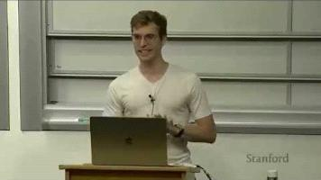

# LLM Architecture and Training

## Stanford lecture

[This 2-hour Stanford lecture explains how ChatGPT and Claude are built](https://www.youtube.com/watch?v=WSYAW4U7ZYc&t=647s).

## What matters when training LLMs

- Architecture - transformers
- Training algorithms and loss
- Data
- Evaluation
- Systems
- Pretraining

## Language models

A language model produces a probability for a sentence being written by a human based on the probabilities of its tokens.

### Autoregressive language models

An autoregressive language model uses a loop to fetch the probability of the next token, given the existing sequence of tokens:

1. Tokenize.
2. Run the forward pass.
3. Predict the probability of the next token.
4. Sample from the distribution.
5. Detokenize.

## Architecture of autoregressive neural language models

1. Tokenize the input.
2. Create embeddings for the token sequence: a vector representation of the sequence.
3. Pass the embeddings through the linear layer of the neural network. The number of outputs matches the number of tokens.
4. Pass the outputs through the softmax function.
5. Receive a probability distribution for the next token.

## Loss

For example, cross-entropy loss aims to classify the index of the next token. We compare the generated target-token probability with the actual token in the context. The aim is to increase the probability of the actual token and decrease the probabilities of the other tokens.

Minimizing the loss is the same as maximizing the likelihood of a given text.

## Tokenizers

Tokenizers produce shorter and more general sequences than characters, and usually shorter sequences than word-level tokenization.

## LLM evaluation: perplexity

The basic idea is validation loss. To make it more interpretable, use perplexity: the average perplexity per token, independent of sequence length.

- Perplexity units range from 1 (minimum) to the length of the tokenizer's vocabulary (maximum).
- The higher the perplexity, the greater the uncertainty about what the next word should be.
- In other words, perplexity is the average number of equally likely choices the model feels it has.
- Perplexity of 1 means the model is perfectly certain.

Perplexity is no longer used for validation because it depends on:

- The tokenizer
- The data being evaluated

It is still used in training, but it is not the whole picture. A model can predict tokens with higher confidence yet perform worse on reasoning tasks.

### Evaluation considerations

1. Sensitivity to prompting and inconsistencies
2. Train/test contamination
