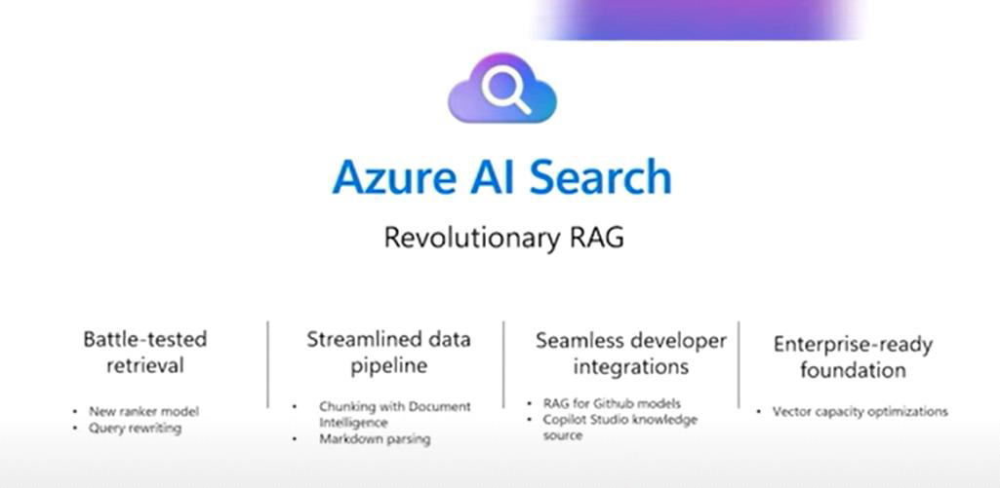

# Journey 1: RAG and Knowledge Retrieval Fundamentals

_Learning session: 27 March 2025_

## Overview

This journey covers the basics of retrieval-augmented generation (RAG), model grounding, and AI Search.

## Incorporating domain knowledge

There are several ways to incorporate domain knowledge into an AI solution:

- **Prompt engineering and in-context learning:** Provide relevant information as part of the prompt.
- **Fine-tuning:** Teach the model new skills permanently.
- **Retrieval augmentation:** Provide new facts temporarily by retrieving them at query time.

## AI Search

> "Indexing is like creating a digital map of all key terms, concepts and structures that are inside these documents."

We cannot retrieve anything without indexing first.

## Vector embeddings

Different models produce different embeddings, with varying vector lengths. Prepare for frequent algorithm changes; this is why validation is crucial.

## Related videos

- [RAG Time introduction](https://www.youtube.com/watch?v=UOsboxxyqew)
- [RAG and knowledge retrieval](https://www.youtube.com/watch?v=bURCZeCSx2A)
