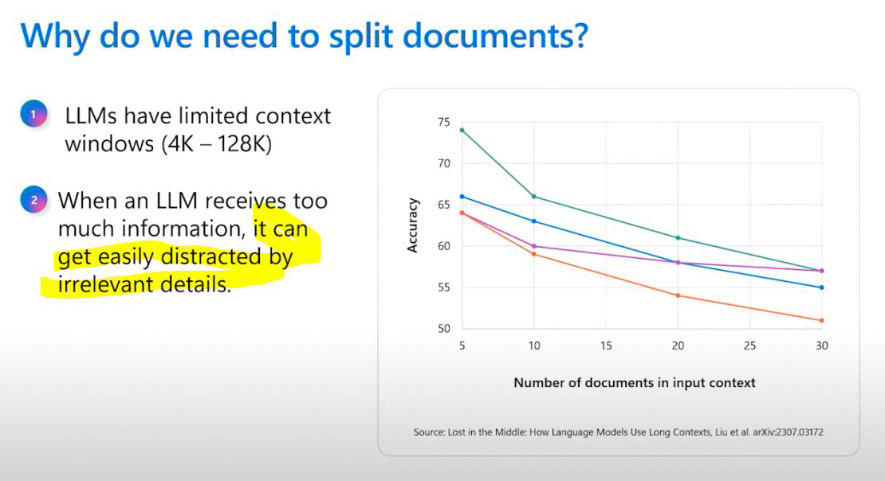
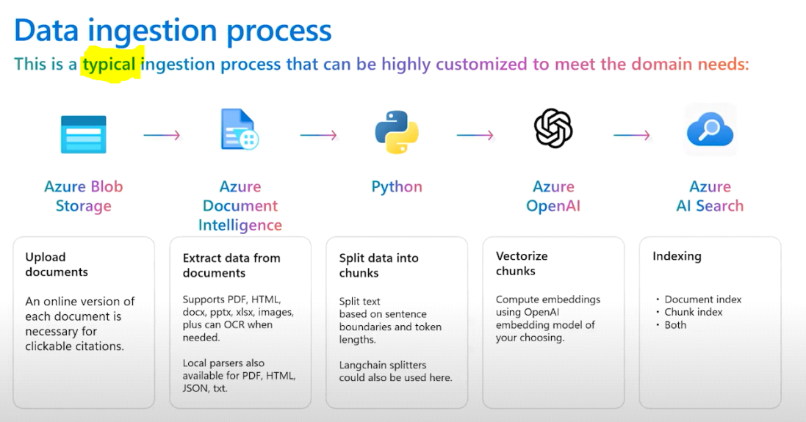
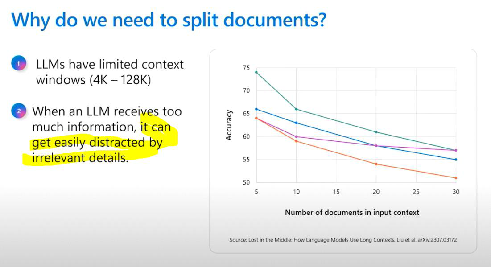
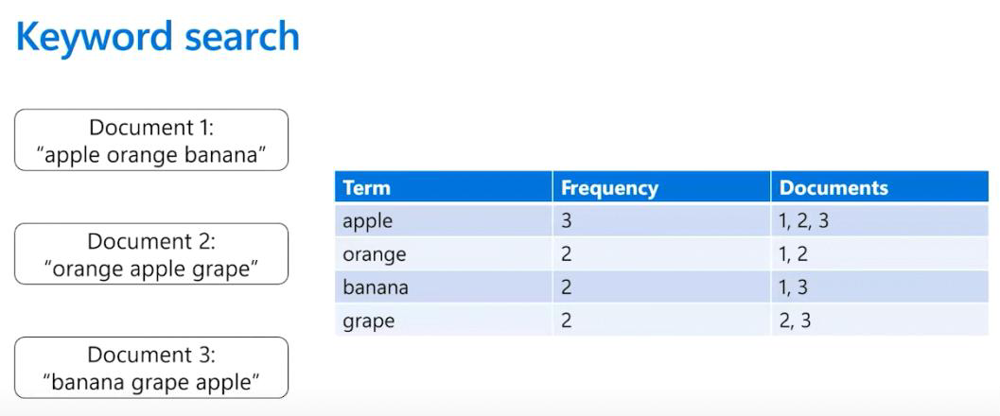
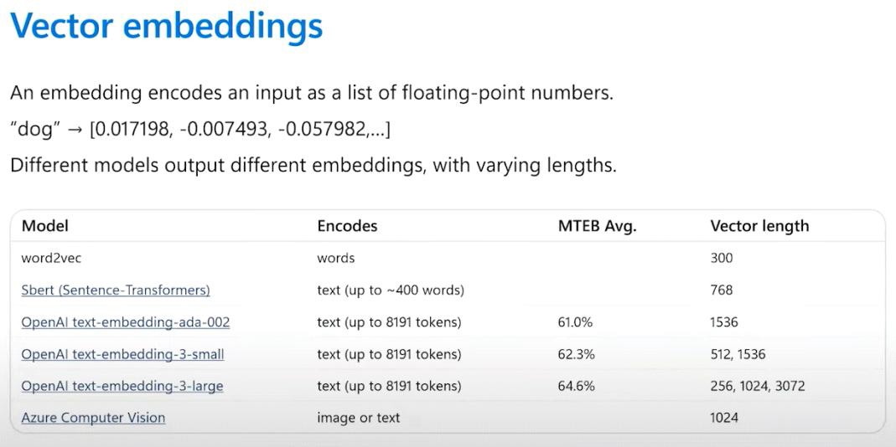
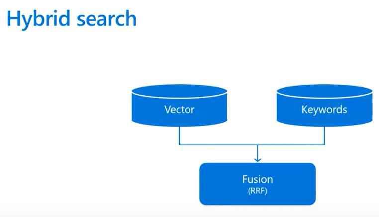
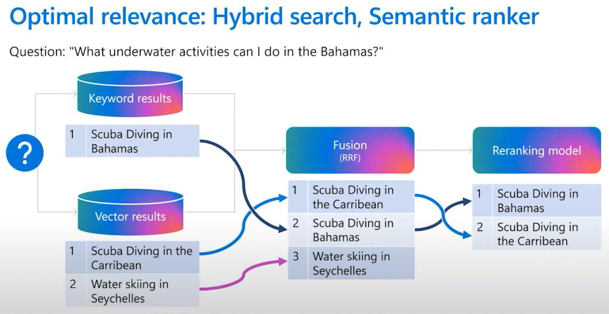
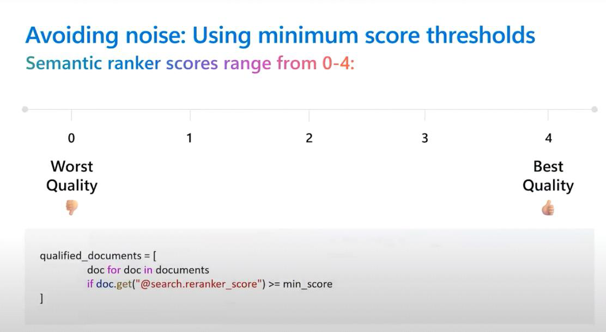
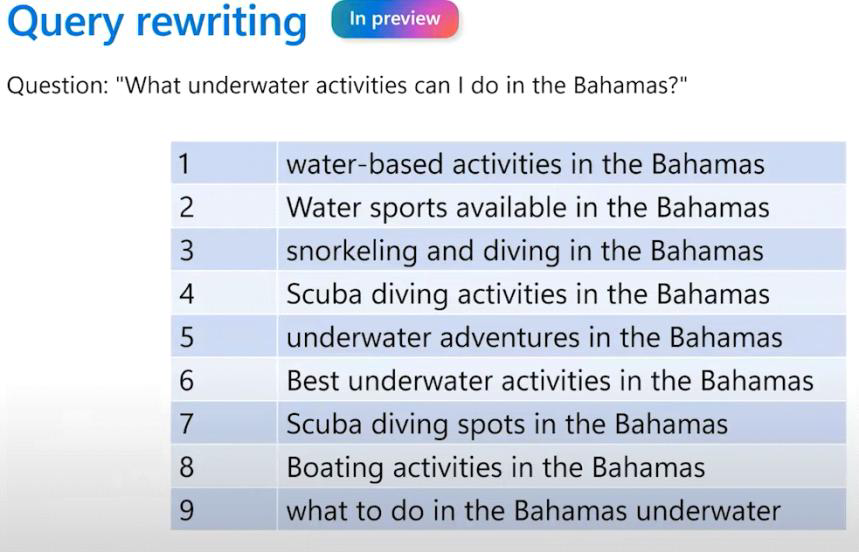

# Journey 2: Build the Ultimate Retrieval System for RAG

_Learning session: 27 March 2025_

## Core topics

- Semantic ranking
- Ranking and query rewriting
- Data ingestion
- Keyword and vector search
- Integrated vectorization

## Integrated vectorization

Integrated vectorization is an in-built feature that enables cloud-based data ingestion with built-in skills.

- **Indexer:** Retrieves raw data from a supported data source and serves as the pipeline engine.
- **Vector index:** Receives the chunked and vectorized content.
- **Skillset:** Configured with a Text Split skill for chunking and an embedding skill for generating vector arrays. The embedding skill can be an Azure OpenAI Embedding skill, a custom skill, or an Azure AI Vision skill.

We need to split documents into chunks because LLMs have a limited context window (4K–128K tokens). The context window includes more than attached documents: prompts, system messages, examples, and chat history also consume context.

## Keyword search

Keyword search is based on word frequency. It is particularly useful for exact terms such as codes, product names, and flight numbers.

## Vector search

Vector search is based on embedding similarity. Different embedding algorithms produce different embeddings and vectors.

We use cosine similarity to calculate distance between vectors. For `ada-002`, cosine similarity values range from 0.7 to 1.

## Hybrid search

Hybrid search combines keyword search, which is useful for exact matches, with vector search, which provides broader semantic context.

Hybrid search returns a list of results. Several techniques can optimize those results:

### Semantic ranker

The semantic ranker reviews the combined results from keyword and hybrid search and changes their order based on relevance.

We can select the most relevant documents for RAG by filtering documents according to their semantic ranking score, where 0 is least relevant and 4 is most relevant.

### Query rewriting

Users do not always write the most effective queries or include the best keywords. Query rewriting can help surface the most relevant documents.

## Follow-up

- Research vector search.
- Research semantic ranking.
- Investigate evaluation tools built into Azure AI.

## Related video

- [Build the ultimate retrieval system for RAG](https://www.youtube.com/watch?v=bURCZeCSx2A)
