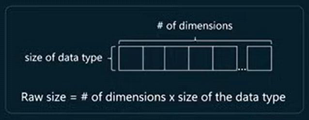
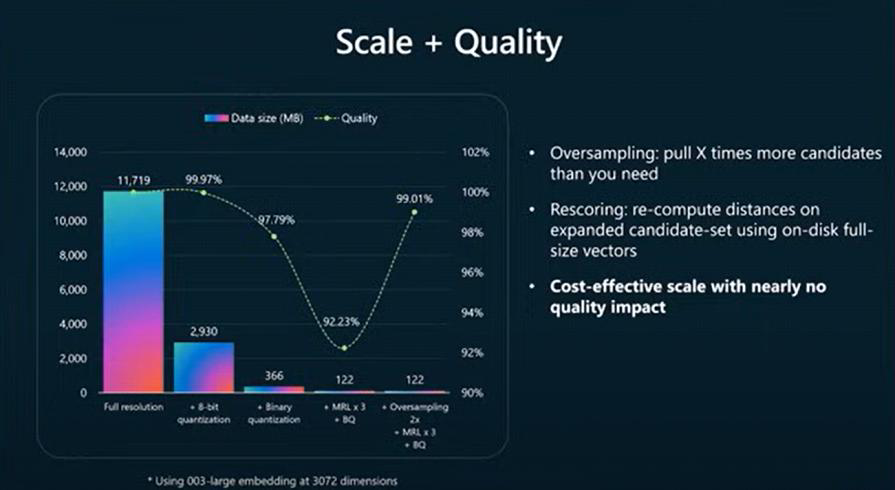
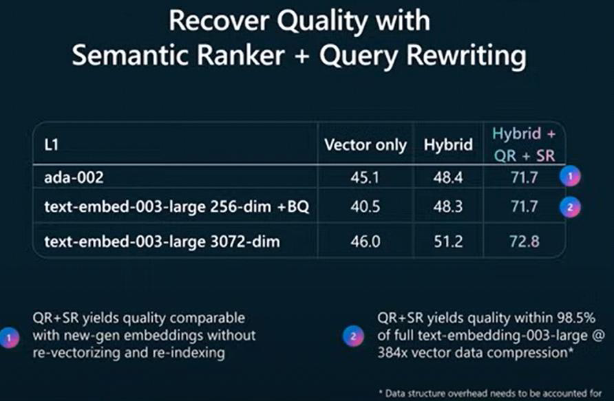

# Journey 3: Optimize Your Vector Index for Scale

_Learning session: 23 April 2025_

As scale grows, cost and latency become increasingly important.

The context window accounts for many things, not just attached documents: prompts, system messages, examples, and chat history must also fit. Although context windows for many LLMs are getting bigger, more context does not always result in optimal retrieval. Too little context does not provide enough relevant information, while too much context can throw the LLM off.

**Advice:** Build a validation system to judge the trade-off between speed and accuracy.

## Vector retrieval optimization

Vector size is calculated as:

> number of vector dimensions × size of the data type

For example, single-precision floating point values use 32 bits, while short integers use 16 bits.

By default, three copies of each vector are stored: one for the vector index, one for rescoring to increase accuracy, and one to support retrieval.

## Ways to optimize vector storage

- Decrease the precision of the data type. For example, storing data as `int8` instead of `float32` reduces the size of each number in a vector.
- To reduce the dimensions of stored vectors without significant quality loss, increase vector density by applying Matryoshka Representation Learning (MRL). For example, using OpenAI's `text-embedding-3-large` model, 1 million vectors with 3,072 dimensions can be reduced from 11.4 GB to 122 MB—a 96× reduction.
- To preserve quality, apply **oversampling** (pull more candidates than you need) and **rescoring** (recompute distances on the expanded candidate set using on-disk, full-size vectors).

See the [Vector Compression notebook](https://github.com/microsoft/rag-time/blob/main/Journey%203%20-%20Optimize%20your%20Vector%20Index%20for%20Scale/sample/3-Vector-Compression.ipynb) for code examples for creating more scalable indexes.

See the [Vector Index optimization video](https://www.youtube.com/watch?v=J3eDgwS8wpo) for additional guidance.

## Improve retrieval quality

Semantic ranking and query rewriting can improve retrieval quality.

When writing documentation for business users, explain prompt engineering and the advantages and limitations of long chat histories and rich context.

**Advice:** Build a validation system to judge the trade-off between speed and accuracy.
