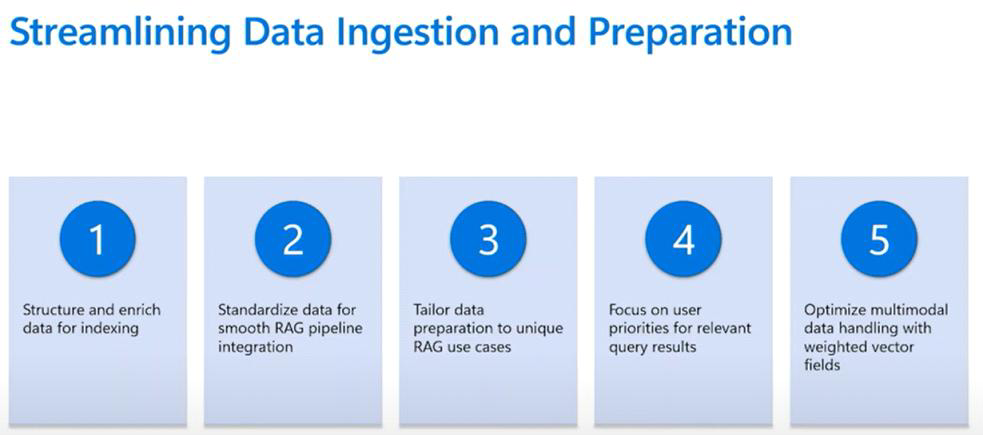
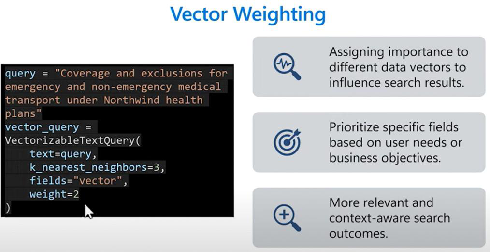

# Journey 4: RAG for All Your Data: Multimodal and Beyond

_Learning session: 3 June 2025_

## Why multimodal workflows matter

RAG is not limited to text. Multimodal workflows can work with images, videos, and audio as well.

## Importing vectorized data in the Azure portal

1. Open the AI Search service and choose **Import vectorized data**.
2. Go through the import process and choose an appropriate data source.
3. Choose which data type to vectorize, such as images, and select the embedding model.
4. Optionally extract text from images.

## Vector weighting

When performing a multi-vector search, assign weights to specific fields to emphasize their importance.

See the [Integrated Vectorization notebook](https://github.com/microsoft/rag-time/blob/main/Journey%204%20-%20RAG%20for%20All%20your%20Data%20Multimodal%20and%20Beyond/sample/integrated-vectorization/azure-search-integrated-vectorization-sample.ipynb).

See the [multimodal RAG video](https://www.youtube.com/watch?v=OFuO9sI5BQc).

