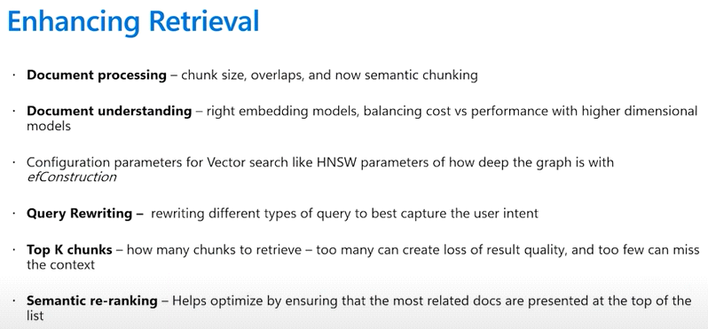
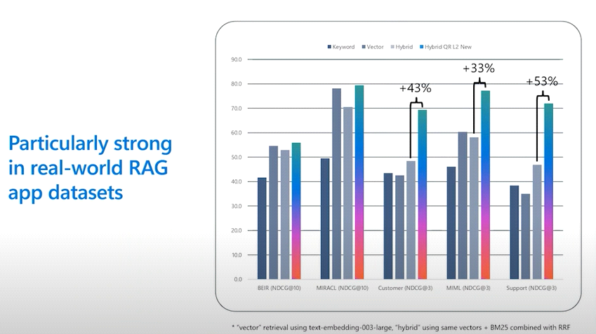

# Journey 5: Hero Use Cases for RAG

_Learning session: 3 June 2025_

Understand your use case and the kinds of questions your users ask:

- Are they asking fact-based questions?
- Are they asking more generative questions, such as asking for specific facts or options for where to go on holiday?
- How grounded are the answers to these questions in your documents?

## Method

Identify methods to enhance retrieval in RAG-based applications.

## Related video

- [Hero use cases for RAG](https://www.youtube.com/watch?v=-yyONUB5b88)
