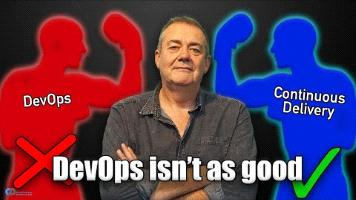

# Dave Farley - Continuous Delivery

## The Most Powerful Software Development Process Is the Easiest

1. Ideal development process:
   - Minimal work
   - Great quality
   - The ability to change our minds: our understanding of the problem and the ideal solution will change over time.
   - Make changes in small steps. This is critical for understanding whether we are making progress and spotting problems.
   - Regularly verify progress
   - Work incrementally
   - Create a working, usable system
   - Keep the system working

- **Vague wish** -> **User story**: expresses a user need, not a solution.
- **Acceptance criteria**: proof that the user need is fulfilled.
- **Executable specification**
- **Design and implement**: continuous integration makes sure that everyone's changes still work together. Test frequently.

### Continuous integration requirements

1. Code
2. Tests

## From Legacy Code to State-of-the-Art Development

- Legacy code
- Rewriting is a difficult task and is not always a good idea.
- Improve modularity.
- Add automated tests.
- Refactor to make things easier. Make changes in small steps, not big jumps.
- Increase the speed of feedback.
- Test for releasability: automate manual regression testing.
- Automate deployment.
- Control the variables.
- Adopt infrastructure as code.

## Gitflow and Continuous Delivery

[Gitflow Isn't Compatible with Continuous Delivery](https://www.youtube.com/watch?v=sHO35WyLJIM&list=PLwLLcwQlnXBxy8H8JEizOcfDh_Vyy6qyv&index=3) by Bryan Finster.

## The Difference Between DevOps and Continuous Delivery

Continuous Delivery focuses more on the outcome—delivering better software faster, based on feedback—while DevOps tends to begin with culture and practices, even if the desired outcome is the same as in Continuous Delivery.

According to Dave, changing the culture first is not always possible, so the emphasis should be on the outcome first. DevOps practices are good and useful, but not all of them need to be in place to create a continuous delivery capability.

## Refactoring

- Extract methods.
- Work to reduce cyclomatic complexity.
- Move related concepts closer together.
- Look out for reuse.
- Work in very small steps.
- Too many function parameters are a red flag.
- Look for patterns and similar operations, and group them together. Wrap them in functions with meaningful, easy-to-understand names.
