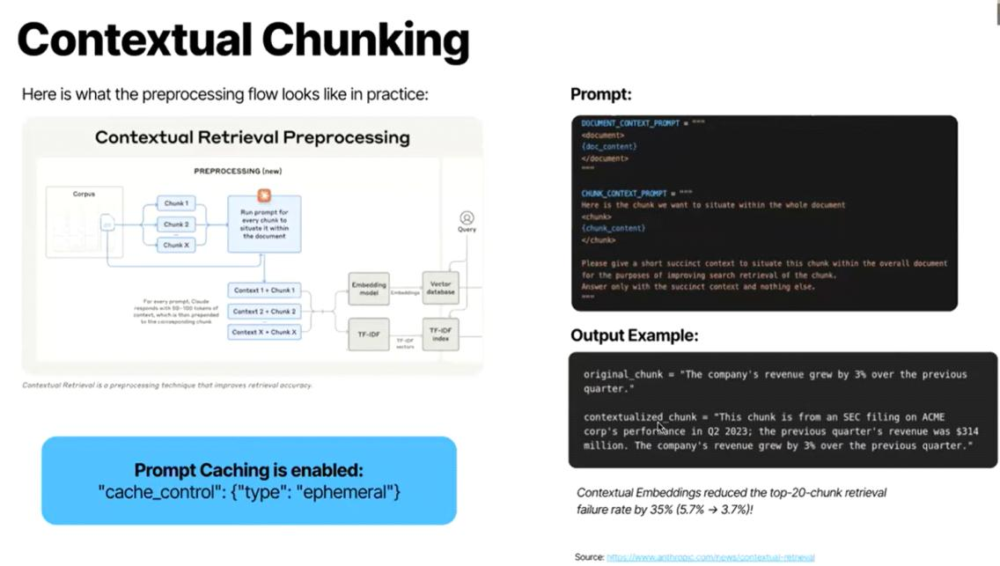
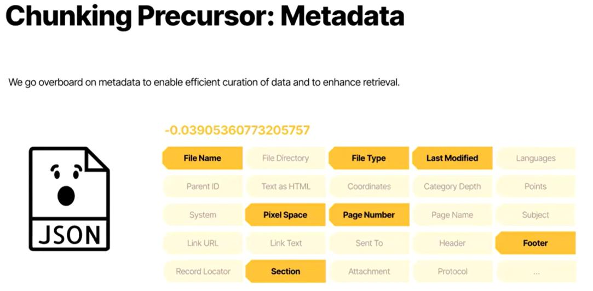
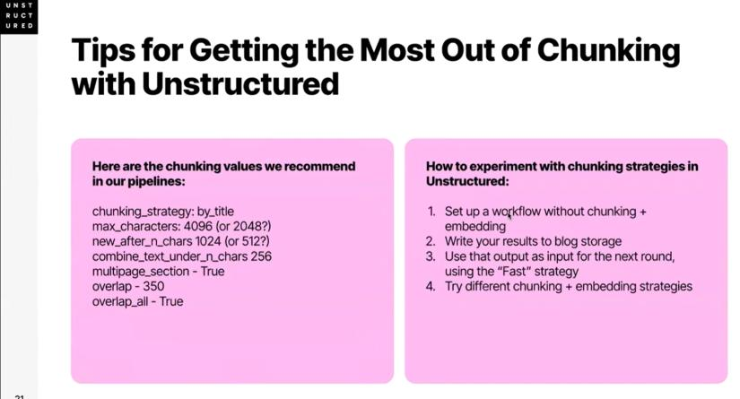

# How to Boost Your RAG Accuracy

## Webinar

[](https://www.youtube.com/watch?v=YTRqM_QSUlA)

[Watch the webinar on YouTube](https://www.youtube.com/watch?v=YTRqM_QSUlA)

## Unstructured

Unstructured extracts various components of a document (text, images, tables, and more) and processes them accordingly.

1. Extract a lot of useful metadata by default, such as the subject, page name, page number, header, footer, and section.
2. Offer flexible chunking strategies, including chunking by title, page, similarity, and context.
3. Use contextual chunking to improve retrieval accuracy.

## Contextual chunking

Here is what the preprocessing flow looks like in practice:



Contextual retrieval is a preprocessing technique that improves retrieval accuracy. Prompt caching is enabled with:

```json
{
  "cache_control": {
    "type": "ephemeral"
  }
}
```

The example notes that contextual embeddings reduced the top-20-chunk retrieval failure rate by 35% (from 5.7% to 3.7%).

Source: [Contextual Retrieval](https://www.databricks.com/blog/2024/10/08/contextual-retrieval.html)

## Chunking precursor: metadata

We go overboard on metadata to enable efficient curation of data and to enhance retrieval.



## Tips for getting the most out of chunking with Unstructured



### Recommended chunking values

```text
chunking_strategy: by_title
max_characters: 4096 (or 2048?)
new_after_n_chars: 1024 (or 512?)
combine_text_under_n_chars: 256
multipage_section: True
overlap: 350
overlap_all: True
```

### Experimenting with chunking strategies in Unstructured

1. Set up a workflow without chunking and embedding.
2. Write your results to blog storage.
3. Use the output as input for the next round, using the “Fast” strategy.
4. Try different chunking and embedding strategies.
