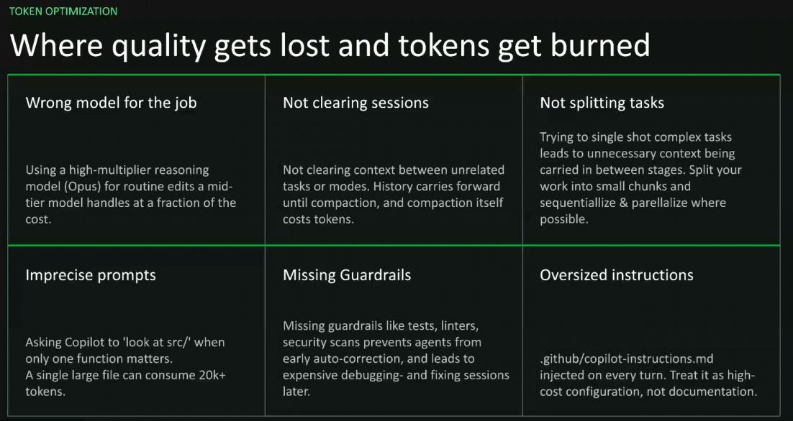
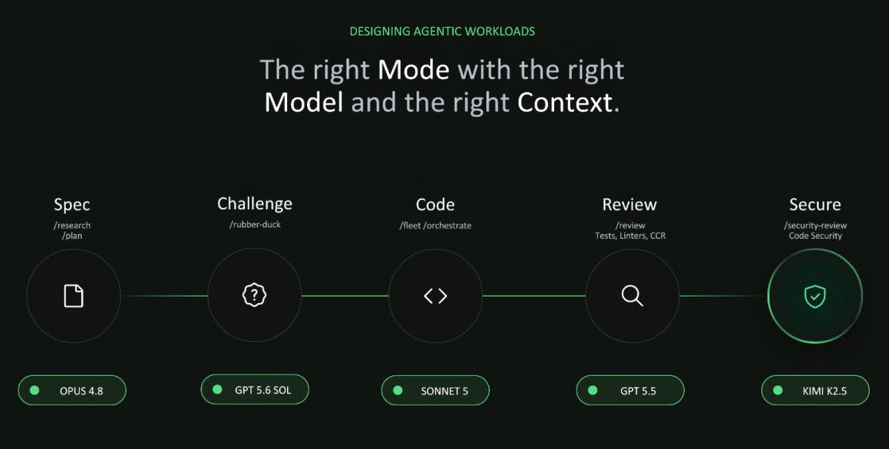

## Different sessions for different tasks

Use different sessions for different tasks, such as testing, refactoring, and implementing a new feature.

## Where quality gets lost and tokens get burned

- **Wrong model for the job:** Using a high-multiplier reasoning model (Opus) for routine edits when a mid-tier model can handle the task at a fraction of the cost.
- **Not clearing sessions:** Not clearing context between unrelated tasks or modes. History carries forward until compaction, and compaction itself costs tokens.
- **Not splitting tasks:** Trying to solve complex tasks in a single shot leads to unnecessary context being carried between stages. Split work into small chunks, then sequence and parallelize where possible.
- **Imprecise prompts:** Asking Copilot to “look at `src/`” when only one function matters. A single large file can consume 20k+ tokens.
- **Missing guardrails:** Without guardrails such as tests, linters, and security scans, agents can auto-correct early and lead to expensive debugging and fixing sessions later.
- **Oversized instructions:** `.github/copilot-instructions.md` is injected on every turn. Treat it as high-cost configuration, not documentation.

## Designing agentic workloads

Use the right mode with the right model and the right context:

1. **Spec** - `/research`, `/plan`
2. **Challenge** - `/rubber-duck`
3. **Code** - `/fleet`, `/orchestrate`
4. **Review** - `/review`, including tests, linters, and code-change review
5. **Secure** - `/security-review`, including code security checks
